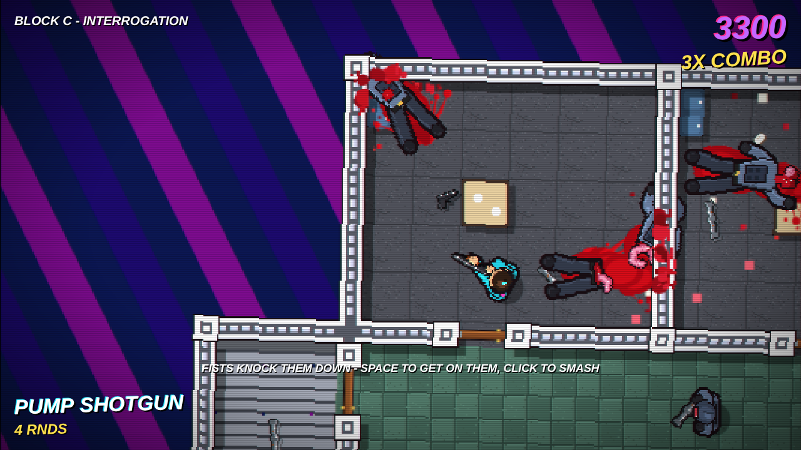
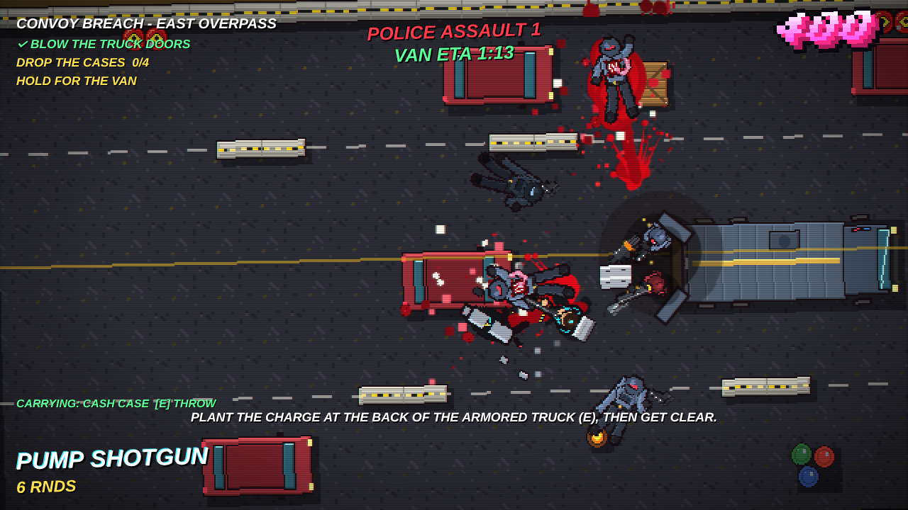
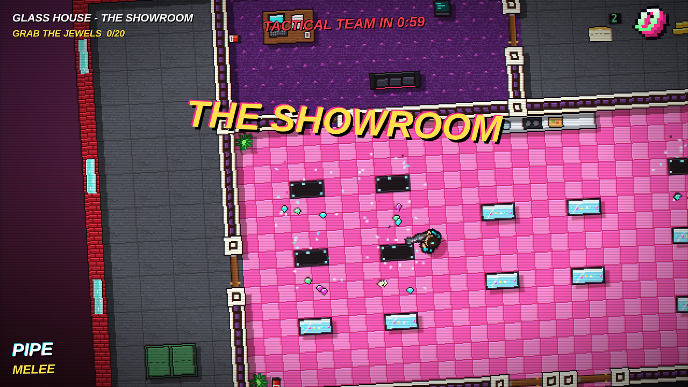
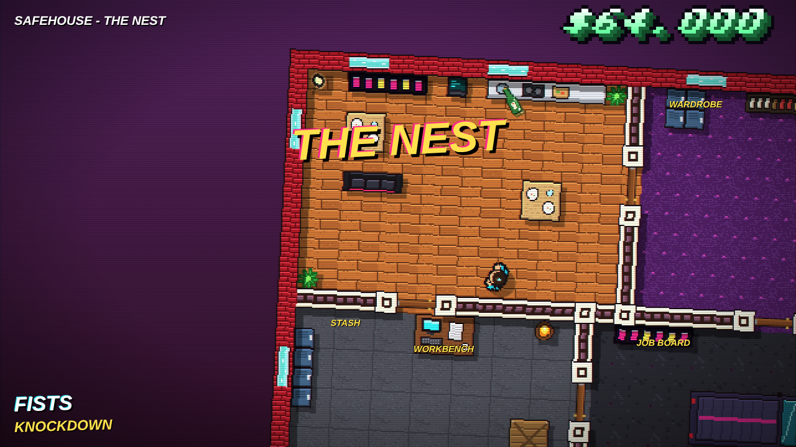
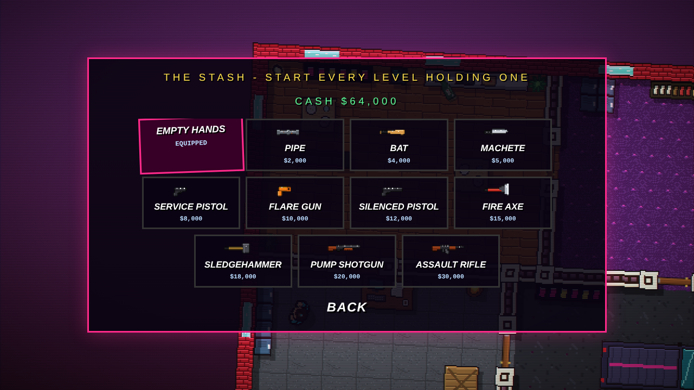

# NEON SIEGE: LOWER CITY

A fast, brutal top-down cyberpunk action game. You fight the Orison corporation through the Lower City of Port Ostra. One hit kills you, and one hit kills them.

It's inspired by the feel of Hotline Miami and the loud heists of Payday. All art, characters, names, music and levels are original and drawn in code.



## Play

Open `dist/index.html` in a desktop browser (Chrome works best). It also runs on Android phones with touch controls.

| Key | Action |
|---|---|
| WASD / mouse | Move / aim |
| Left click | Attack or shoot |
| Right click | Pick up or throw a weapon |
| Space | Get on a downed enemy, then click to finish them |
| Shift (hold) | Look further |
| Middle click / Ctrl | Lock on |
| E | Use: free captives, terminals, drills, loot bags, safehouse stations |
| F / G | Implant ability / grenade |
| R / Esc | Restart floor / pause |

## What's in it

- **Story:** 12 levels across 2 acts. Each level has floors, objectives and bosses. You pick an implant (Overdrive, Dash, Plating, Neural Spike, Reflex, Ghost, Arm Blades) before every level.
- **Jobs:** 5 loud heists: Tidewater Vault, Convoy Breach, Glass House, Cold Storage and Skyline Safe. They have loot bags, drills that jam, charges, keycards, assault waves and a payout.
- **Safehouse:** a walkable hideout where you spend the cash you earn on a starting weapon, upgrades (Kevlar, Brawler, Steady Hands and more), jackets and job planning.
- **Weapons:** about 25, including pipe, bat, katana, arc saw, sledgehammer, fire axe, bottle, pistols, silenced pistol, revolver, smart pistol, SMG, assault rifle, shotguns, sniper rifle, belt-fed machine gun, rail gun, rockets, flare gun and grenades.
- **Combat:**
  - Enemies hear gunshots through rooms and doorways, and only the nearest few come to check.
  - Patrols and enemy weapons change every run.
  - Wounded enemies crawl away.
  - Gore depends on the weapon you use.
- **Destruction:** windows, explosive barrels, fire extinguisher smoke, fish tanks, weak walls, doors blown off their hinges, sparking machines, fire and bloody footprints.
- **End of level:** a grade with style bonuses, plus optional camera sway.

| | |
|---|---|
|  |  |
|  |  |

## Project layout

```
head.html      page, menus and styles
src/*.js       game code, joined in name order (00_core ... 70_ui)
build.py       joins head.html + src/*.js into dist/index.html
dist/          the built, playable game (one file)
tools/         tests, map analyzer, fuzzer, art previews
test.js        main regression + performance soak test
shot.js        scripted screenshots
docs/screens/  screenshots for this page
```

Main files in `src/`:

| File | What it holds |
|---|---|
| `13_hd.js`, `14_hdobj.js` | Character, weapon and furniture art |
| `40`–`42_levels*.js` | Story levels |
| `43_jobs.js` | The jobs |
| `45_safehouse.js` | Safehouse, shop and planning |
| `50_game.js` | Core gameplay and AI |
| `54_heist.js` | Heist mechanics |
| `57_weapons.js`, `57_wpn2.js` | Weapons |
| `59_destroy.js` | Destruction |
| `60_render.js` | Rendering |
| `70_ui.js` | Menus and results |

## Build

```
python3 build.py
```

## Tests

The tests need Node.js with [Playwright](https://playwright.dev) and Chrome. Set `CHROME=/path/to/chrome` if it isn't found.

```
node test.js                 # regression + 60 fps soak on every floor
node tools/levels_test.js    # every story level is completable
node tools/jobs_test.js      # every job is completable + heist mechanics
node tools/safehouse_test.js # shop, perks, planning, payouts
node tools/weapons_test.js
node tools/feat_test.js
node tools/act2_test.js
node tools/doorjam.js
node tools/fuzz.js           # random play, looks for errors
node tools/analyze.js        # map checks + overview images in shots/maps
```
